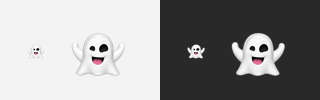

# Ghost menu-bar icon

`Sources/MacToolbox/Resources/MenuBarGhost.png` is a transparent PNG created
with the built-in image generation tool from the user's Memoji pose screenshot.
It recreates the selected pose rather than relying on a system emoji font:
both arms raised, unequal black eyes, and an open smile with a pink tongue.

The image is displayed in its original colors at 22 points wide, preserving
its aspect ratio. SwiftPM supplies it for development; the packaging script
copies it into the app's `Contents/Resources` so the app remains portable.

Native AppKit preview on light (left) and dark (right) backgrounds. Each pair
shows the 22-point icon followed by a 3× enlargement:

Generation prompt:

> Use case: background-extraction. Asset type: native macOS menu-bar icon.
> Edit target: the attached screenshot. Extract only the selected white 3D
> ghost character, matching the large preview at bottom left and the selected
> bottom-row middle pose. Preserve the reference pose and expression: both
> rounded arms raised, facing forward, little left black eye and larger right
> black eye, open happy black mouth with pink tongue, white softly shaded
> sheet body and scalloped bottom. Isolate this single character on a genuinely
> transparent background, centered and tightly framed with a small even
> transparent margin. Clean crisp edges at high resolution for later
> downscaling. No circular gray background, no UI, no selection frame, no text,
> no other ghosts, no cast shadow outside silhouette. Preserve exact silhouette
> and friendly facial identity as closely as possible.
